# My Diploma Thesis

**Art Tokenization on Sui**

The thesis, application code, diagrams, screenshots, demonstration videos and
editable graphics for my diploma thesis at NTUA.

The project explores physical artwork tokenization on Sui through certification,
fractional ownership, a marketplace with artist royalties, and verifiable
condition reports from external sources.

**Nikolaos Tziris**

School of Electrical and Computer Engineering, NTUA. 2026.

- [Read the thesis in the NTUA Library](https://artemis.ece.ntua.gr/handle/123456789/20365)
- [Watch the demonstrations](videos/README.md)
- [Deployment guide](code/README.md)
- [Build the thesis](thesis/README.md)
- [Typst template](https://github.com/ntziris/ntua-thesis-template-greek)
- [Reproduce the evaluation](docs/reproducibility.md)

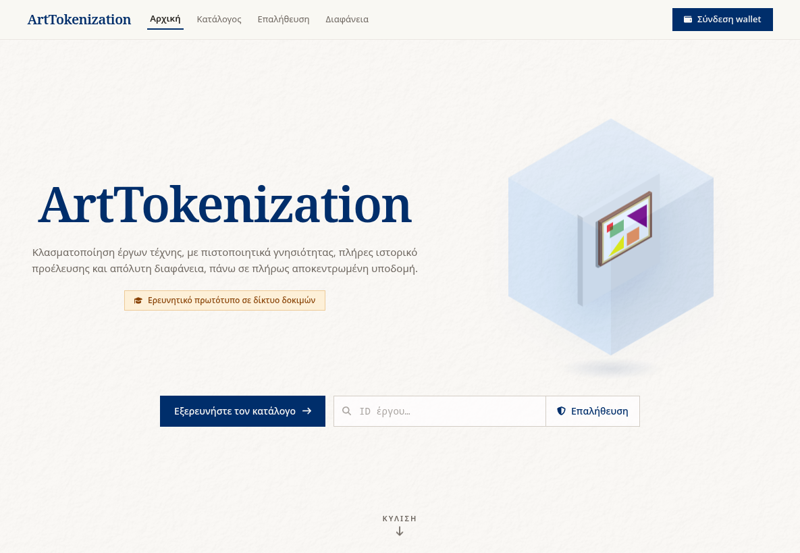

## Thesis deliverables

The repository follows the organization of the submitted deliverables.

| Material | Contents |
| --- | --- |
| [Thesis PDF](thesis.pdf) | Submitted thesis document, 157 pages |
| [Thesis PDF with a color cover](thesis-color.pdf) | Submitted decorated edition, 160 pages |
| [Application source](code/) | Smart contracts, frontend, oracle and supporting tools |
| [UML diagrams](diagrams/README.md) | 14 diagrams in PNG, SVG and editable Visual Paradigm formats |
| [Screenshots](screenshots/README.md) | All 28 submitted interface screenshots |
| [Videos](videos/README.md) | All 14 demonstration recordings |
| [Thesis source](thesis/) | Typst text, bibliography, assets and evaluation data |
| [Graphics](graphics/README.md) | 126 illustration and design files, including editable drawings |
| [Typst template](https://github.com/ntziris/ntua-thesis-template-greek) | Reusable template in its own repository |

The two PDFs above are preserved from the deliverable bundle dated
29 September 2026. They precede the later library formatting and bibliography
corrections included in the Typst source. For the published document, use the
[NTUA Library record](https://artemis.ece.ntua.gr/handle/123456789/20365).

## Features

- Artwork issuance, gallery custody, and attached certificates of authenticity.
- Fractional ownership, consolidation, and trading with artist resale royalties.
- Public files on Walrus and encrypted high-resolution files protected with Seal.
- Signed source readings aggregated by a Rust oracle built on Nautilus and AWS
  Nitro Enclaves, with attestation checked on Sui.
- A Greek-language React interface served as a Walrus Site.

The application was developed and evaluated on **Sui testnet**. The checked-in
addresses and object IDs describe the reference deployment. Its services and
stored blobs may no longer be available. Archived evaluation data can be
processed without that deployment. This is a research prototype, not an audited
production service.

## Screenshots

The screenshots show the Greek interface and the main stages of the artwork
lifecycle. Open an image to see it at full size.

[Browse all 28 screenshots](screenshots/README.md).

| Artwork issuance | Certificate of authenticity |
| --- | --- |
| 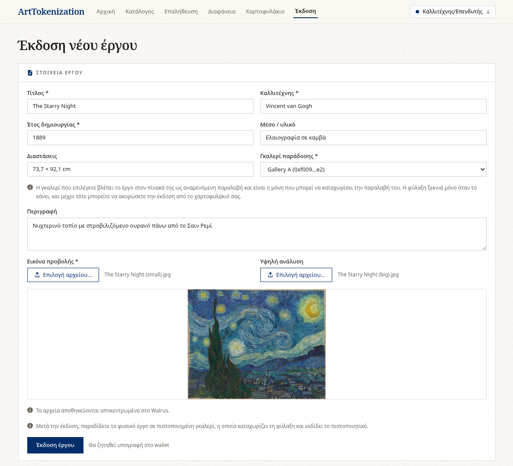 | 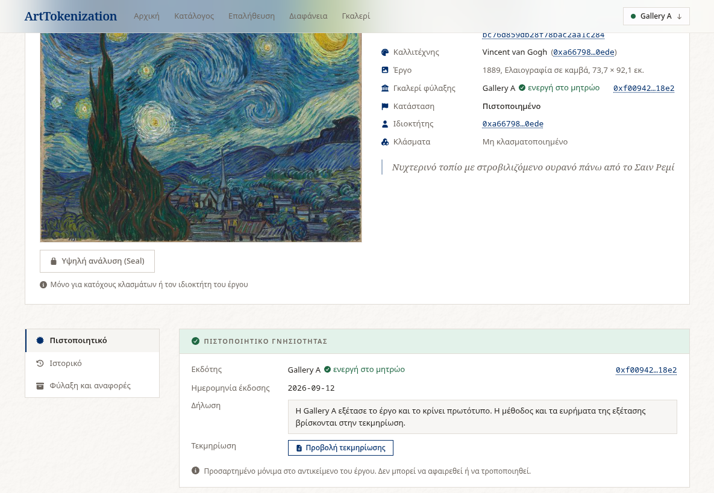 |

| Fractional ownership | Purchase and royalty breakdown |
| --- | --- |
| 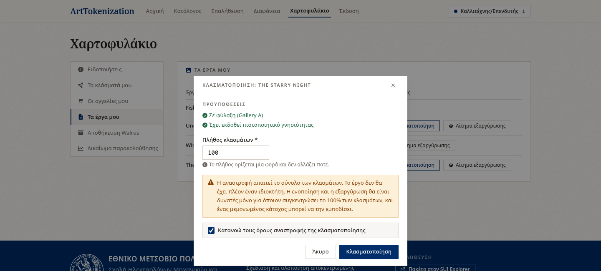 | 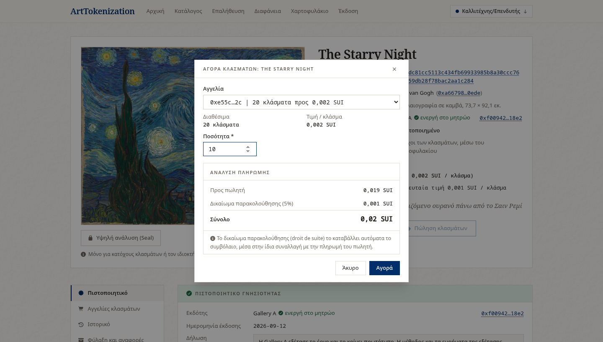 |

| High-resolution image access with Seal | External source simulator |
| --- | --- |
| 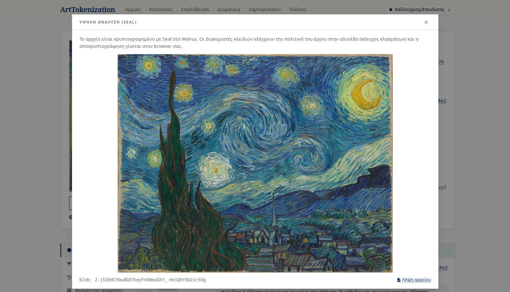 | 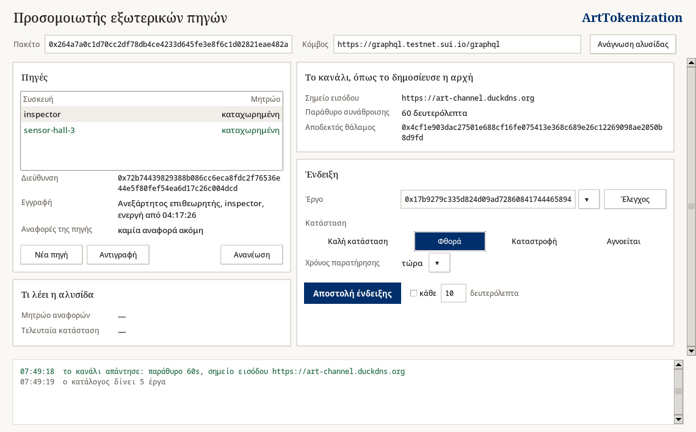 |

| Artwork history | Certificate verification |
| --- | --- |
| 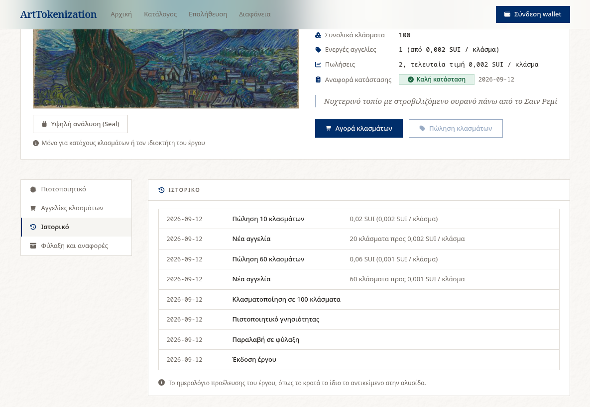 | 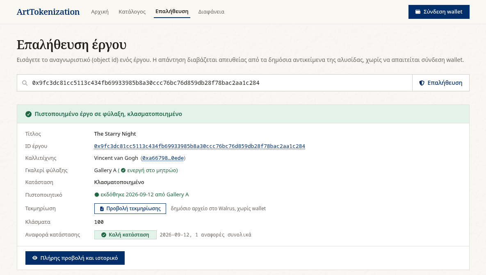 |

## Video demonstrations

The recordings show complete interactions with the reference deployment,
including wallet confirmations and the resulting application state. Select a
preview to open its video file. If GitHub does not show a player, download the
file and open it in a browser or media player.

| Issue an artwork | Create fractional ownership |
| --- | --- |
| [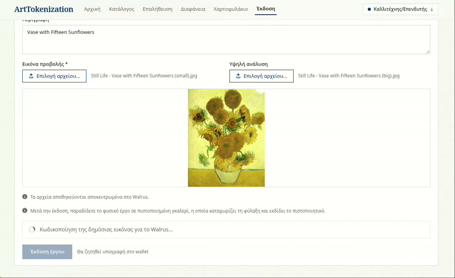](videos/03-issue-artwork.webm) | [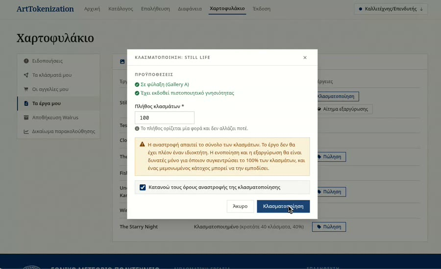](videos/06-fractionalize-artwork.webm) |

| Buy fractions and pay royalties | Submit an external condition report |
| --- | --- |
| [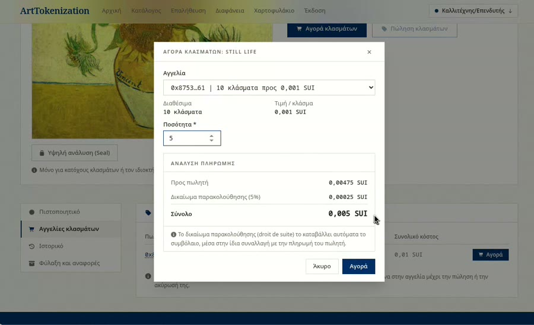](videos/08-buy-fractions-royalty.webm) | [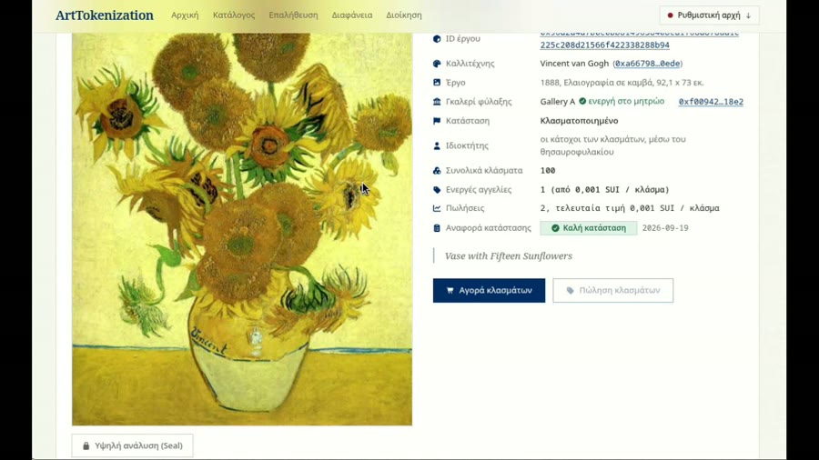](videos/12-submit-condition-report.webm) |

[Browse all 14 demonstration videos](videos/README.md), including wallet
connection, gallery custody, certification, Seal access, source registration,
loss declarations, and fraction burning.

## Architecture

[](diagrams/components.svg)

The browser reads chain state and submits wallet-signed transactions directly.
The oracle handles the external report channel. The
[14 UML diagrams](diagrams/README.md) document the object model, trust boundaries,
artwork lifecycle and transaction flows. Each diagram includes its editable
Visual Paradigm project and PNG and SVG exports.

## Application source

| Directory | Contents |
| --- | --- |
| `code/smart-contracts/` | Move contracts and unit tests |
| `code/frontend/` | React, TypeScript, Vite, and Tailwind interface |
| `code/enclave/` | Rust report channel and Nautilus infrastructure |
| `code/source-simulator/` | Desktop simulator for signed readings |
| `code/scripts/` | Deployment and operation scripts |
| `code/portal/` | Walrus Sites portal configuration |
| `code/certificates/` | Printable certificate generator |

## Run the interface

With Node.js and pnpm installed:

```sh
cd code/frontend
pnpm install --frozen-lockfile
pnpm dev
```

The development server uses the reference testnet configuration. A fresh
installation requires publishing the contracts and configuring storage and the
oracle as described in the [deployment guide](code/README.md).

## Tests and evaluation

```sh
# From the repository root
(cd code/smart-contracts && sui move test)
(cd code/enclave/src/nautilus-server && cargo test --locked)
(cd code/frontend && pnpm lint && pnpm build)
python3 code/source-simulator/keys.py
python3 thesis/scripts/make_gas_figures.py
```

See [reproducibility](docs/reproducibility.md) for prerequisites and scope.
The evaluation script uses archived transaction effects and needs no wallet,
network connection, or Python dependencies.

## Thesis and citation

**Σχεδίαση και Υλοποίηση Αποκεντρωμένης Εφαρμογής για Tokenization Έργων Τέχνης
στο Οικοσύστημα του Sui Blockchain**. Nikolaos Tziris, NTUA, 2026.
Supervisor: Panagiotis Tsanakas.

The [NTUA Library record](https://artemis.ece.ntua.gr/handle/123456789/20365)
is the authoritative reference for the submitted document. Citation metadata is
provided in [CITATION.cff](CITATION.cff). See [provenance](docs/provenance.md) for
how the submitted material relates to this source distribution.

## Copyright and permissions

Copyright (c) 2026 Nikolaos Tziris. All rights reserved for original material,
subject to the existing thesis permissions and third-party licenses described
in [LICENSE.md](LICENSE.md).

This repository does not grant a general open source license for the author's
original code. The published thesis keeps its existing copyright and reuse
notice. Third-party code, fonts, citation styles, and artwork retain their
respective rights and licenses.
