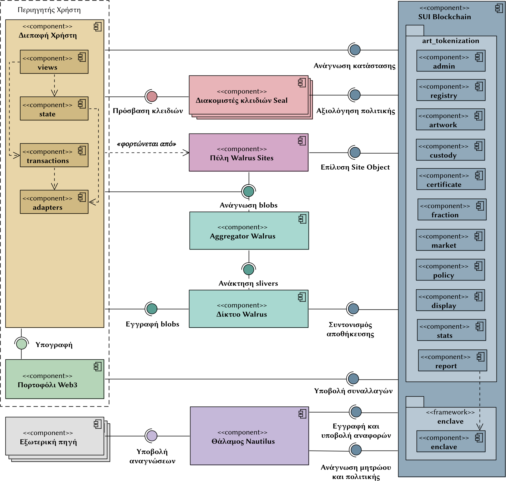
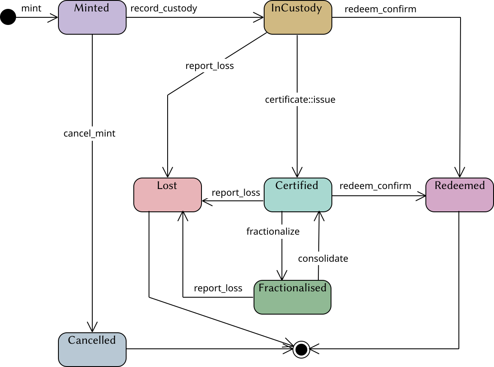

# UML diagrams

All 14 diagrams from the submitted deliverables are provided in three formats.
Open PNG for a preview, SVG for the vector export, or VPP to edit the project
in Visual Paradigm.

| Diagram | Preview | Vector | Editable project |
| --- | --- | --- | --- |
| Application components | [PNG](components.png) | [SVG](components.svg) | [VPP](components.vpp) |
| Deployment | [PNG](deployment.png) | [SVG](deployment.svg) | [VPP](deployment.vpp) |
| Sui object model | [PNG](sui-object-model.png) | [SVG](sui-object-model.svg) | [VPP](sui-object-model.vpp) |
| Index model | [PNG](index-model.png) | [SVG](index-model.svg) | [VPP](index-model.vpp) |
| Oracle components | [PNG](oracle-components.png) | [SVG](oracle-components.svg) | [VPP](oracle-components.vpp) |
| Artwork lifecycle | [PNG](artwork-lifecycle.png) | [SVG](artwork-lifecycle.svg) | [VPP](artwork-lifecycle.vpp) |
| Artwork issuance | [PNG](mint-sequence.png) | [SVG](mint-sequence.svg) | [VPP](mint-sequence.vpp) |
| High-resolution image access with Walrus and Seal | [PNG](sealed-image-sequence.png) | [SVG](sealed-image-sequence.svg) | [VPP](sealed-image-sequence.vpp) |
| Public image access with Walrus | [PNG](public-image-sequence.png) | [SVG](public-image-sequence.svg) | [VPP](public-image-sequence.vpp) |
| Oracle components in theory | [PNG](oracle-theory-components.png) | [SVG](oracle-theory-components.svg) | [VPP](oracle-theory-components.vpp) |
| Oracle registration with Nautilus | [PNG](oracle-registration-sequence.png) | [SVG](oracle-registration-sequence.svg) | [VPP](oracle-registration-sequence.vpp) |
| Report submission to the oracle | [PNG](oracle-submission-sequence.png) | [SVG](oracle-submission-sequence.svg) | [VPP](oracle-submission-sequence.vpp) |
| Seal and Walrus interaction in theory | [PNG](seal-walrus-theory-sequence.png) | [SVG](seal-walrus-theory-sequence.svg) | [VPP](seal-walrus-theory-sequence.vpp) |
| Oracle report aggregation and issuance | [PNG](oracle-aggregation-sequence.png) | [SVG](oracle-aggregation-sequence.svg) | [VPP](oracle-aggregation-sequence.vpp) |

## Architecture

## Artwork lifecycle

Original filenames and checksums are recorded in the
[deliverable manifest](../docs/deliverables-manifest.json).

See the [copyright and permissions](../LICENSE.md) for this material.
