# Application screenshots

All 28 screenshots from the submitted deliverables. Select an image to view
it at full size. The interface is in Greek.

The thesis source also retains these images in its own asset directories.

| Listing | Payment breakdown |
| --- | --- |
| [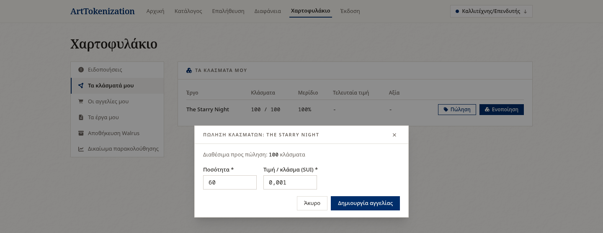](listing.png) |  |

| Admin events | Admin galleries |
| --- | --- |
| [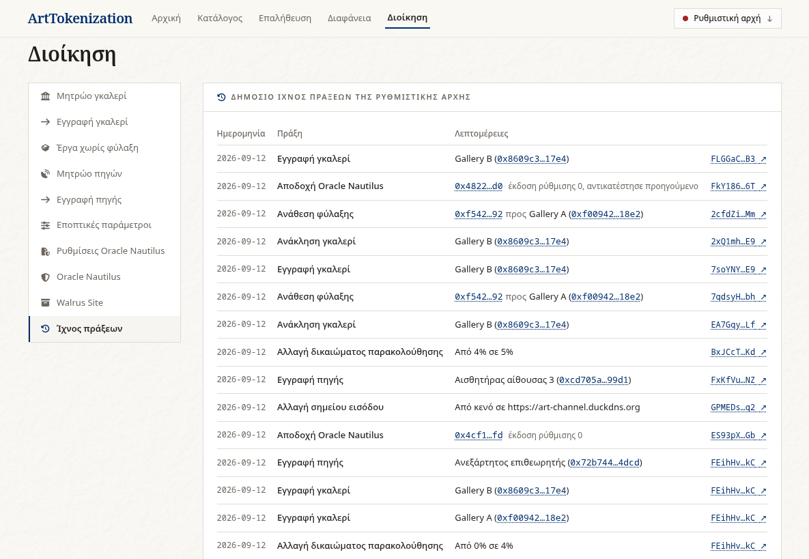](admin-events.png) | [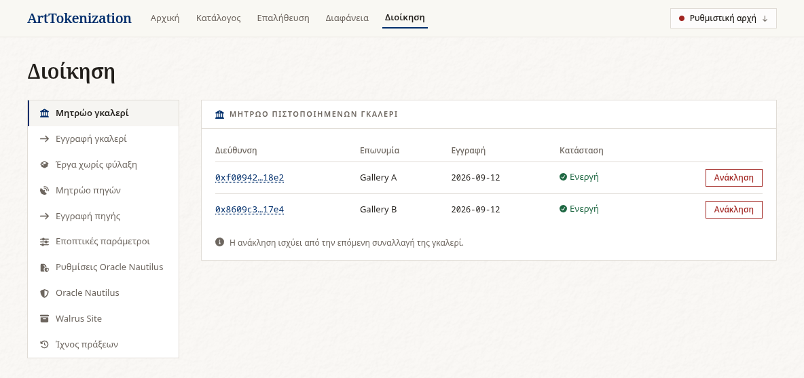](admin-galleries.png) |

| Notifications gallery report | Verify |
| --- | --- |
| [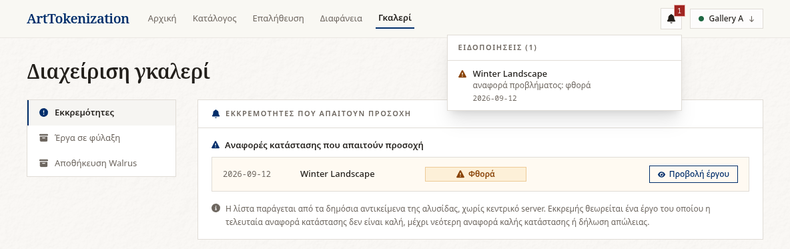](notifications-gallery-report.png) |  |

| Artwork history | Catalogue card |
| --- | --- |
|  | [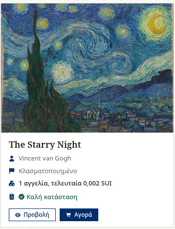](catalogue-card.png) |

| Catalogue search | Catalogue pagination |
| --- | --- |
| [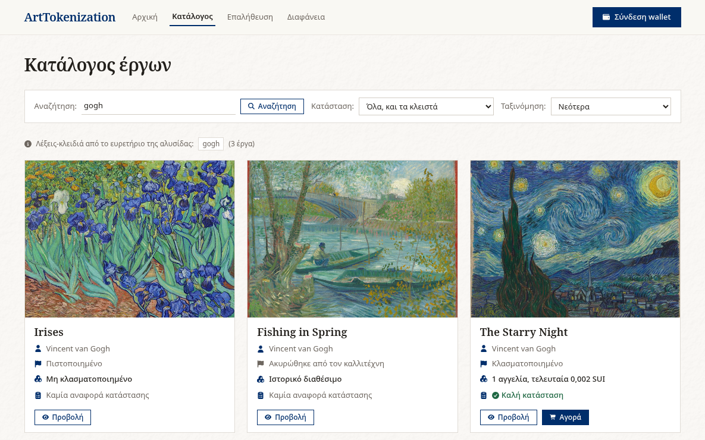](catalogue-search.png) | [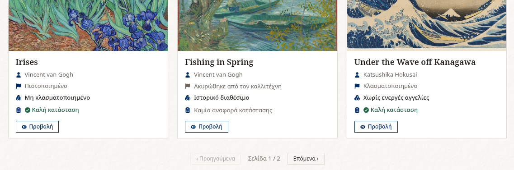](catalogue-pagination.png) |

| Catalogue sort | Catalogue status |
| --- | --- |
| [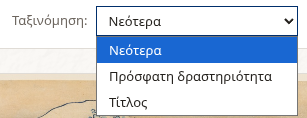](catalogue-sort.png) | [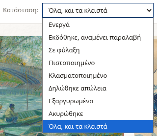](catalogue-status.png) |

| Loss after | Fractionalize |
| --- | --- |
| [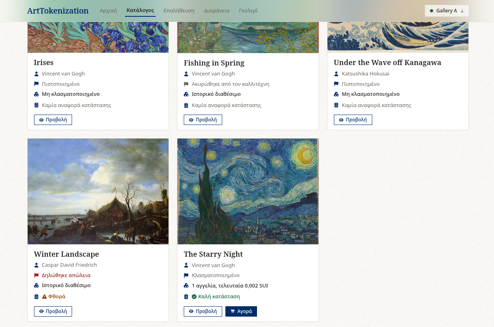](loss-after.png) |  |

| Mint | Account menu |
| --- | --- |
|  | [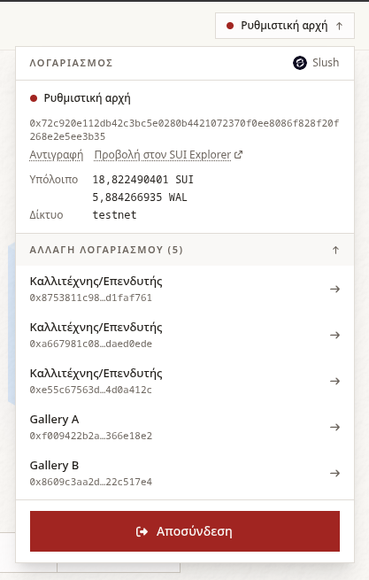](account-menu.png) |

| Notification example | Connect modal |
| --- | --- |
| [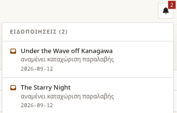](notification-example.png) | [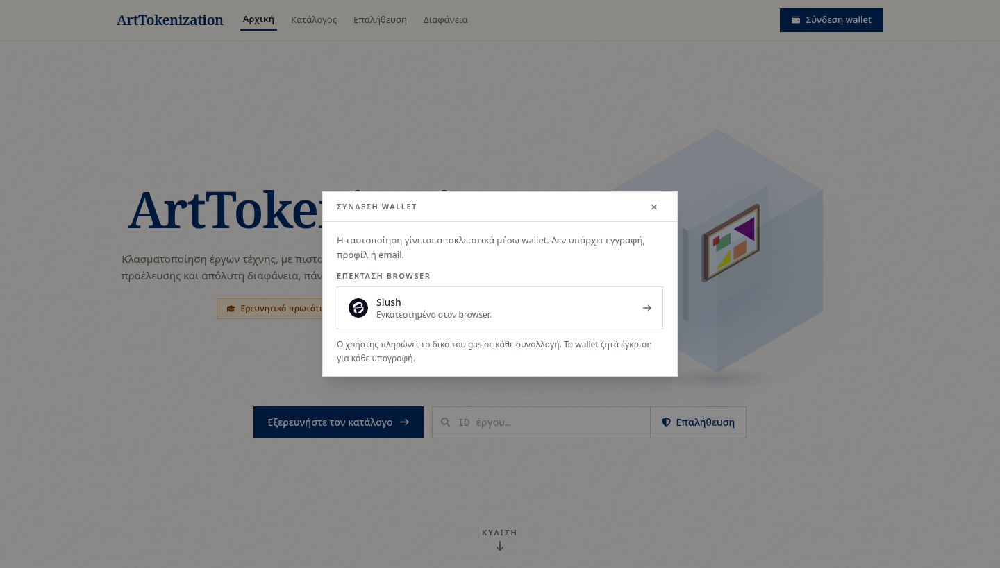](connect-modal.png) |

| Artwork certified | Gallery certificate |
| --- | --- |
|  | [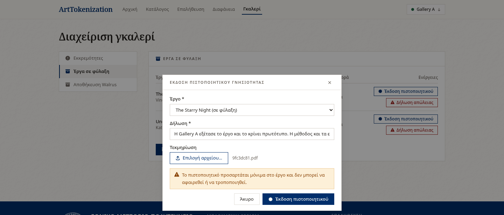](gallery-certificate.png) |

| Fractions wallet | Source simulator |
| --- | --- |
| [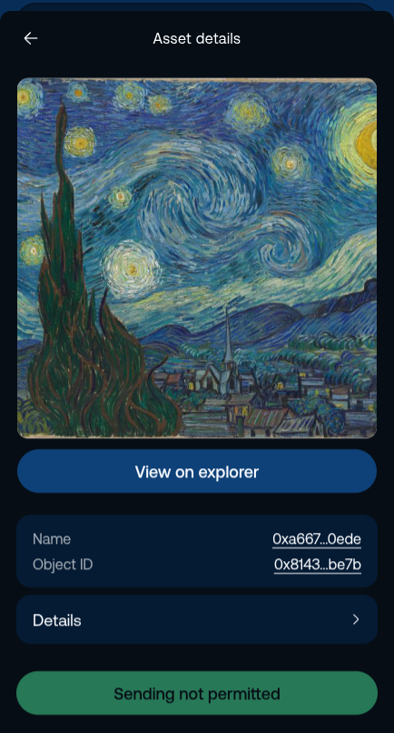](fractions-wallet.png) |  |

| Seal granted | Connect flow |
| --- | --- |
|  | [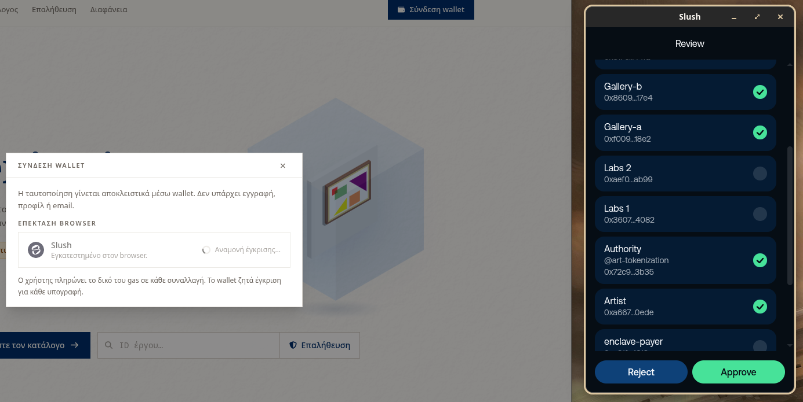](connect-flow.png) |

| Consolidate modal | Connected |
| --- | --- |
| [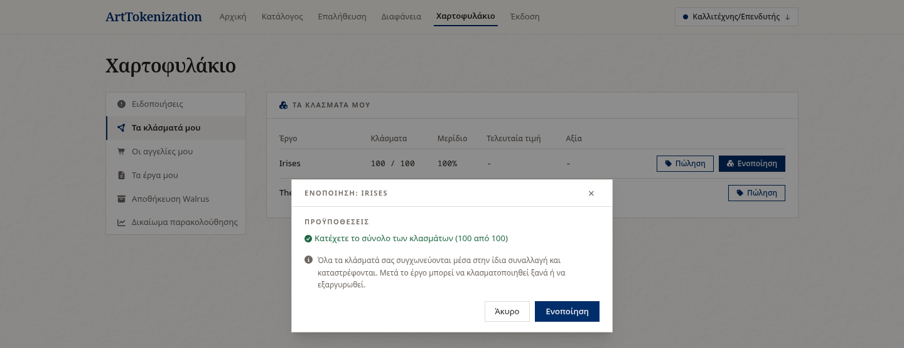](consolidate-modal.png) | [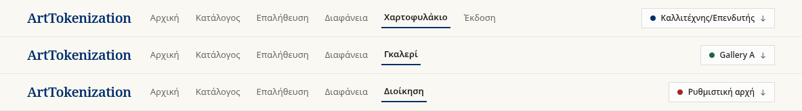](connected.png) |

| Connect approve | Report artwork |
| --- | --- |
| [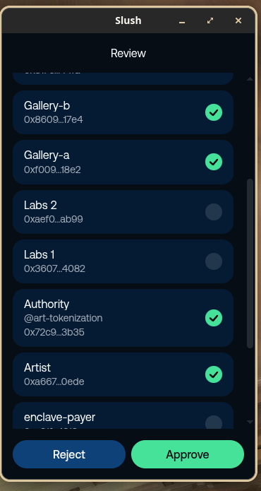](connect-approve.png) | [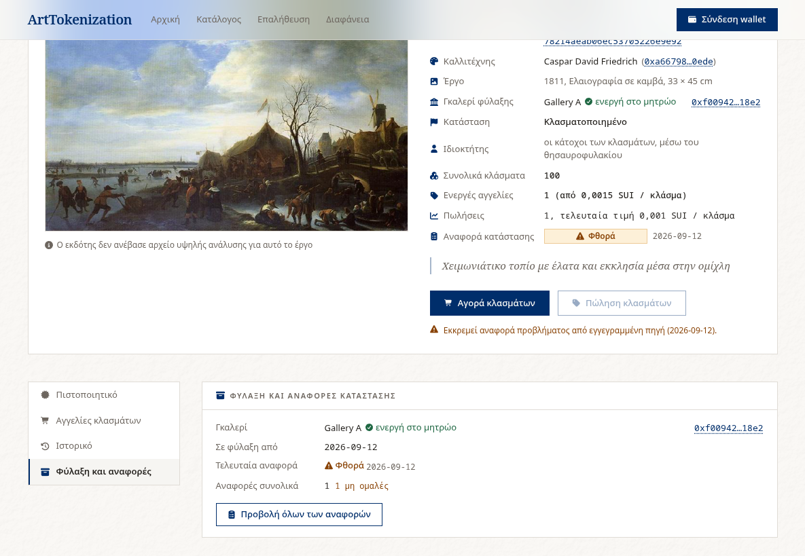](report-artwork.png) |

Original filenames and checksums are recorded in the
[deliverable manifest](../docs/deliverables-manifest.json).

See the [copyright and permissions](../LICENSE.md) for this material.
